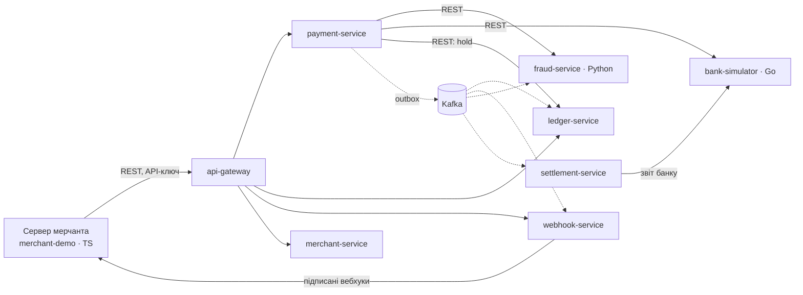

# Kopiyka

Платіжна платформа на мікросервісах, pet-проєкт рівня «міні-Stripe». Мерчанти приймають оплату карткою через публічний REST API, роблять повернення й отримують підписані вебхуки. Гроші обліковуються в double-entry ledger і щодня звіряються з банком.

> Назва робоча. Копійка — мінорна одиниця гривні, і всі суми тут зберігаються саме в копійках.

**Головна інженерна задача:** гроші не губляться і не списуються двічі, навіть коли трапляються таймаути, повтори запитів, падіння сервісів і дублікати повідомлень.

## Архітектура



Суцільні стрілки — синхронний REST, пунктирні — події через Kafka.

| Сервіс | Мова | Роль |
|---|---|---|
| api-gateway | Java · Spring Cloud Gateway | вхідна точка: маршрутизація, API-ключі, rate limiting |
| merchant-service | Java | мерчанти, тарифи, API-ключі |
| payment-service | Java | платежі, повернення, саги, ідемпотентність |
| ledger-service | Java | подвійний запис, баланси, холди |
| webhook-service | Java | події та вебхуки з підписом і ретраями |
| settlement-service | Java · Spring Batch | settlement і reconciliation з банком |
| fraud-service | Python · FastAPI | скоринг ризику |
| bank-simulator | Go | «зовнішній банк» з керованим хаосом |
| merchant-demo | TypeScript · Node | демо-магазин, e2e- і контрактні тести |
| fx-service *(опційно)* | Java | курси Monobank / НБУ з fallback |

## Документація

**Почни звідси:** [сервіси простими словами](docs/services/README.md) — що робить застосунок, хто є хто у світі платежів і навіщо кожен сервіс.

1. [Архітектура і ключові рішення](docs/01-architecture.md)
2. [Ключові флоу, стейт-машини, сценарії збоїв](docs/02-flows.md)
3. [REST API: конвенції та ендпоінти](docs/03-rest-api.md). OpenAPI-контракти: [публічний API](api/openapi/public-api.yaml), [bank-simulator](api/openapi/bank-simulator.yaml)
4. [Kafka: топіки, події, гарантії](docs/04-kafka.md)
5. [Модель даних і проводки](docs/05-data-model.md)
6. [Поетапний план від MVP](docs/06-roadmap.md)

## Стек

Java 25 · Spring Boot 4 · Spring Cloud Gateway · PostgreSQL 18 · Kafka 4 (KRaft) · Debezium · Schema Registry + Avro · Redis · Resilience4j · Spring Batch · Keycloak · OpenTelemetry + Grafana LGTM · Testcontainers · Toxiproxy · k6 · Docker Compose · GitHub Actions · Go · Python/FastAPI · TypeScript

## Структура репозиторію (цільова)

```
.
├── api/openapi/            # контракти OpenAPI, з них генерується код
├── docs/                   # архітектура, флоу, ADR
├── libs/platform-starter/  # спільний Spring Boot starter: помилки, ідемпотентність, outbox, inbox
├── services/
│   ├── api-gateway/
│   ├── merchant-service/
│   ├── payment-service/
│   ├── ledger-service/
│   ├── webhook-service/
│   ├── settlement-service/
│   ├── fx-service/
│   ├── fraud-service/      # Python
│   └── bank-simulator/     # Go
├── clients/merchant-demo/  # TypeScript
├── deploy/                 # docker-compose, конфіги Debezium, дашборди Grafana
├── load-tests/             # k6
└── http/                   # .http-запити для ручної перевірки
```

## Статус

Проєктування завершене. Наступний крок — фаза 0 з [плану](docs/06-roadmap.md).
