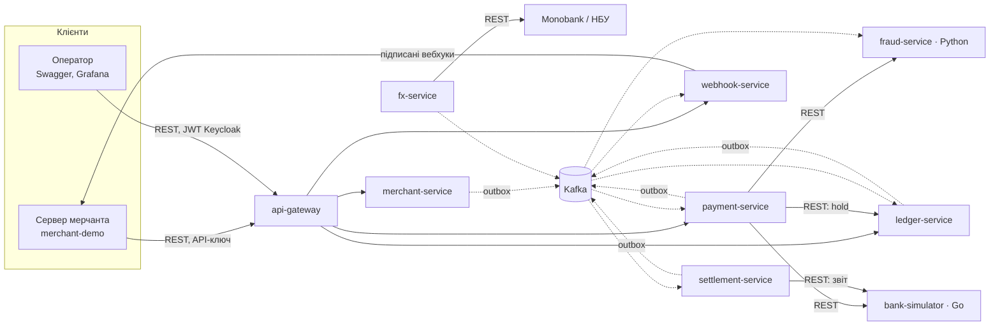

# 01. Архітектура

## 1. Що будуємо

Kopiyka — платіжна платформа для мерчантів (інтернет-магазинів). Мерчант створює платежі через REST API, ми проводимо їх через «банк», ведемо облік грошей у double-entry ledger, повідомляємо мерчанта вебхуками, робимо повернення і щодня звіряємося з банком.

**Головний принцип: коректність грошей важливіша за доступність.** Краще відповісти `503` або `202 processing`, ніж списати гроші двічі чи загубити платіж.

### Функціональні вимоги

- Платежі: створення, підтвердження карткою, автоматичне або ручне списання (authorize → capture), скасування (void), автоскасування авторизацій, які так і не списали.
- Повернення: повні й часткові.
- Баланси мерчанта (`pending` / `available` / `reserved`) та історія руху коштів.
- Події та вебхуки з підписом і ретраями.
- Антифрод-скоринг перед зверненням до банку.
- Щоденний settlement і reconciliation з банком.
- Курси валют (опційно, для антифроду).

### Нефункціональні вимоги

Цілі перевіряються k6 і chaos-тестами.

| Ціль | Значення |
|---|---|
| Втрачені або подвоєні операції | 0 під хаосом: таймаути, падіння, дублікати |
| Результат, який уже бачив мерчант | ніколи не змінюється (`succeeded` не стає `failed`) |
| `confirm`, p95 | < 800 мс, коли затримка банку ~200 мс |
| Пропускна здатність | ≥ 100 confirm/с на ноутбуці |
| Відставання ledger від payment | p95 < 2 с |

### Припущення й обмеження

- Тільки test-режим, один регіон, один «банк» (bank-simulator).
- Один платіж — одна валюта, без конвертації. Валюти: `UAH`, `USD`, `EUR`.
- Мерчантів заводить оператор. Публічної реєстрації немає.
- Увесь час зберігається в UTC.
- Команда — одна людина, 10–15 год/тиждень. Залізо — ноутбук з 16 ГБ RAM. Тому в docker-compose є профілі, кожному JVM-сервісу дається `-Xmx256m` і вмикаються віртуальні потоки.

### Поза обсягом (свідомо)

Справжня PCI DSS-сертифікація, реальні банки, 3-D Secure. UI-дашборда немає: замість нього Swagger UI, `.http`-колекція, Grafana і `merchant-demo`. Multi-region теж поза обсягом.

### Оцінка навантаження (back-of-the-envelope)

Сценарій «як у проді»: 1 млн платежів на добу.

| Величина | Розрахунок | Результат |
|---|---|---|
| Середній потік | 1 000 000 / 86 400 с | ≈ 12 платежів/с |
| Пік (×10) | | ≈ 120 платежів/с |
| Події Kafka | 3–5 на платіж | пік ≈ 600 повідомлень/с |
| Проводки ledger | 3 на capture | пік ≈ 360 рядків/с |
| Обсяг даних | ≈ 5 КБ на платіж у всіх БД | ≈ 5 ГБ/добу |

**Висновок:** для Kafka і Postgres такий обсяг скромний. Вузькими місцями будуть не пропускна здатність, а конкуренція за ті самі рядки (hot accounts у ledger) і затримка банку. Тому дизайн оптимізований під коректність, а не під масштаб.

## 2. Глосарій

| Термін | Значення |
|---|---|
| Мерчант | клієнт платформи (магазин), який інтегрується через API |
| Authorization | банк блокує суму на картці покупця (hold). Гроші ще не списані |
| Capture | фактичне списання авторизованої суми, буває частковим |
| Void | скасування авторизації до capture |
| Refund | повернення вже списаних грошей |
| Settlement | банк перераховує платформі гроші за день (за мінусом повернень) |
| Reconciliation | звірка наших записів зі звітом банку |
| Ledger | журнал проводок за подвійним записом, джерело правди про гроші |
| Hold у ledger | резерв коштів на балансі мерчанта під повернення |
| Minor units | сума цілим числом у копійках або центах: 10050 = 100,50 грн |
| Pivot | крок саги, після якого назад дороги немає, можна тільки вперед |

## 3. Сервіси

| Сервіс | Мова | Відповідає за | Дані | Фаза |
|---|---|---|---|---|
| `api-gateway` | Java, Spring Cloud Gateway | вхідна точка: маршрутизація, перевірка API-ключа, rate limiting, `Request-Id` | Redis | 1 |
| `merchant-service` | Java | мерчанти, тарифи, API-ключі | `merchant_db` | 1 |
| `payment-service` | Java | платежі й повернення, оркестрація саг, операції з банком, ідемпотентність | `payment_db` | 1 |
| `ledger-service` | Java | рахунки, проводки, холди, баланси | `ledger_db` | 1 |
| `bank-simulator` | Go | «зовнішній банк-еквайр»: authorize, capture, void, refund, звіти, хаос | `bank_db` | 1 |
| `webhook-service` | Java | публічні події, endpoints, підписані доставки з ретраями | `webhook_db` | 3 |
| `merchant-demo` | TypeScript (Node) | демо-магазин: працює з API, приймає вебхуки; e2e- і Pact-тести | — | 3 |
| `fraud-service` | Python (FastAPI) | скоринг: правила, velocity-лічильники, ML-модель | Redis, `fraud_db` | 4 |
| `fx-service` *(опційно)* | Java | курси: Monobank → НБУ → останній відомий | `fx_db`, Redis | 4 |
| `settlement-service` | Java, Spring Batch | щоденний settlement, reconciliation, розбіжності | `settlement_db` | 5 |

**Ядро** — gateway, payment, ledger і bank-simulator: на них тримається вся історія про гроші. Решта — сателіти, кожен з яких додає окрему тему.

### Внутрішня структура Java-сервісу (hexagonal)

```
payment-service/src/main/java/.../payment/
├── domain/            # Payment, Refund, Money, PaymentStatus — без Spring
├── application/       # use cases (ConfirmPayment, CreateRefund) і порти (BankPort, FraudPort)
├── adapter/in/web/    # контролери, що реалізують згенеровані з OpenAPI інтерфейси
├── adapter/in/jobs/   # фонові задачі: inquiry, auto-void
├── adapter/out/db/    # репозиторії, outbox
├── adapter/out/bank/  # RestClient + Resilience4j
└── adapter/out/fraud/
```

Залежності контролює ArchUnit-тест: `domain` не імпортує Spring і адаптери. Простий CRUD пишемо на JPA. Умовні апдейти, `SKIP LOCKED` і ledger пишемо на `JdbcClient`: там важливо бачити кожен SQL-запит.

## 4. Схема взаємодії



## 5. Як сервіси спілкуються

**Правило:** синхронний REST — коли відповідь потрібна, щоб продовжити поточний запит. Kafka — для фактів, на які реагують інші сервіси.

| Взаємодія | Тип | Чому так |
|---|---|---|
| мерчант → gateway → сервіси | REST | публічний API |
| payment → fraud | REST, таймаут 300 мс | рішення потрібне до звернення в банк |
| payment → bank | REST, таймаут 3 с | API банку — це HTTP, а від результату залежить статус платежу |
| payment → ledger (hold) | REST | до звернення в банк треба знати, чи вистачає коштів |
| payment → ledger (проводки) | Kafka | крок після pivot: ledger може тимчасово лежати, гроші не загубляться |
| payment → webhook | Kafka | вебхуки не повинні гальмувати платіж |
| settlement → ledger | Kafka | settlement — це факт, ledger проводить його ідемпотентно |
| тариф мерчанта для payment | REST + кеш, у фазі 5 — compacted-топік | щоб прибрати синхронну залежність |

Правила для кожного міжсервісного виклику:
- **Таймаут завжди є** (connect + read). Нескінченних дефолтів не лишаємо.
- **Ретраїмо тільки ідемпотентне:** `GET` або `POST` з ключем ідемпотентності. Exponential backoff з jitter і загальний бюджет часу.
- **Circuit breaker на кожну залежність** (Resilience4j). Стан breaker'а видно в Grafana.
- **Gateway ніколи не ретраїть `POST`.**
- **Ніколи не тримаємо транзакцію БД відкритою під час HTTP-виклику.** Confirm складається з кількох коротких транзакцій (`TransactionTemplate`), а не з одного `@Transactional` на весь метод.

## 6. Володіння даними

- **Database-per-service.** У кожного сервісу своя БД і свій користувач Postgres, доступу до чужих таблиць немає. Локально це один інстанс Postgres з кількома базами, у проді були б окремі.
- **Чужі дані — тільки через API або події.** Приклад: тариф мерчанта payment-service бере з merchant-service (REST + кеш). У фазі 5 він береться з compacted-топіка `merchants.state.v1` у локальну таблицю (event-carried state transfer).
- **Звітам, яким потрібні дані кількох сервісів** (settlement), будуємо власну проєкцію з подій, а не робимо join через мережу.

## 7. Патерни консистентності

Деталі — у [02-flows.md](02-flows.md).

| Проблема | Рішення | Де |
|---|---|---|
| Клієнт повторив запит після таймауту | `Idempotency-Key` + збережена відповідь | payment, webhook |
| Два запити одночасно змінюють один платіж | умовний перехід стану `UPDATE … WHERE status = ?` + `version` | payment |
| Зберегли в БД, але не відправили подію (dual write) | Transactional Outbox: спершу polling, потім Debezium | усі продюсери |
| Подія прийшла двічі | ідемпотентний консюмер: `inbox` або унікальний `external_ref` | ledger, webhook, settlement |
| Транзакція, що охоплює payment, bank і ledger | оркестрована сага з pivot-кроком і компенсаціями | payment |
| Сервіс упав посеред виклику банку | write-ahead intent: запис `bank_operations` у статусі `pending` комітиться до виклику, потім recovery-job | payment |
| Банк не відповів (таймаут — це ще не відмова) | статус `unknown`, потім status inquiry з backoff | payment |
| Гроші «з'явилися нізвідки» або зникли | double-entry: сума проводок = 0, `CHECK (balance >= 0)`, trial balance job | ledger |
| Наші дані розійшлися з банком | щоденна reconciliation | settlement |

## 8. Кешування

| Що | Де | TTL та інвалідація | Чому це безпечно |
|---|---|---|---|
| API-ключ → мерчант | gateway: Redis + Caffeine на 5 с | 60 с, негативний кеш 10 с; у фазі 6 — подія `api_key.revoked` | відкликаний ключ живе ≤ 60 с. Це компроміс, його фіксуємо в ADR |
| Тариф мерчанта | payment-service, Caffeine | 5 хв; у фазі 5 — локальна таблиця з compacted-топіка | комісія фіксується на платежі в момент capture |
| Курси валют | fx-service: Redis + Postgres | 5 хв (ліміт Monobank) | застарілий курс має позначку `stale` |
| Відповіді на `GET` | клієнт: `ETag` і `304` | — | сервер щоразу перевіряє версію |
| Баланси | не кешуємо поза ledger | — | гроші читаємо тільки з джерела правди |

## 9. Безпека

- **API-ключі.** Формат `sk_test_` + 32 випадкові байти в base62. Зберігаємо тільки SHA-256-хеш, префікс і last4. Ключ високоентропійний, тож bcrypt тут не потрібен і тільки вбив би латентність (для паролів — навпаки). Ключ показується один раз. Активних ключів може бути кілька, щоб ротувати без простою.
- **Gateway** перевіряє ключ, **видаляє** всі вхідні заголовки `X-Merchant-*` і додає власний `X-Merchant-Id`. Інакше клієнт міг би підробити мерчанта. `/internal/**` gateway не маршрутизує.
- **Service-to-service (фаза 6).** Keycloak client credentials. Кожен сервіс валідує JWT і scope (`ledger:holds:write`). До фази 6 внутрішні API доступні лише всередині docker-мережі.
- **Admin API (фаза 6).** Keycloak, ролі `admin` і `support`.
- **Картки.** Номер картки (PAN) живе тільки в пам'яті під час виклику банку. Зберігаємо brand, last4 і fingerprint = HMAC-SHA256(PAN, secret). У логах номер маскується: окремий тип `SensitiveString`, у якого `toString()` повертає `****`. Це приклад «зменшення PCI scope».
- **Секрети вебхуків** потрібні для підпису, тому їх **шифруємо** (AES-GCM, ключ з env, пізніше з Vault), а не хешуємо, як API-ключі.
- **SSRF.** URL вебхука задає мерчант, тому перевіряємо схему, резолвимо DNS і блокуємо приватні, loopback і link-local адреси (`10.0.0.0/8`, `172.16.0.0/12`, `192.168.0.0/16`, `127.0.0.0/8`, `169.254.0.0/16`, `::1`, `fc00::/7`). Перевірка повторюється при кожній доставці (захист від DNS rebinding), редиректи не виконуємо. У dev — allow-list для `merchant-demo`.
- **Секрети конфігурації** лежать у `.env`, у git — тільки `.env.example`. У CI — Dependabot або Renovate і сканування образів Trivy.

## 10. Спостережуваність

- **Трейсинг: OpenTelemetry.** Контекст (W3C `traceparent`) передається через REST, Kafka-заголовки й outbox. Виходить один трейс від gateway до Python- і Go-сервісів.
- **`Request-Id`** у відповіді — це trace id. Вставляєш його в Grafana і бачиш увесь шлях запиту.
- **Метрики (Micrometer → Prometheus):**
  - `payments_total{status}`, `payment_confirm_seconds` (histogram)
  - `bank_requests_seconds{operation,outcome}`, `bank_operations_unknown` (gauge)
  - `outbox_lag_seconds`, consumer lag, розмір DLT
  - `webhook_deliveries_pending`
  - `ledger_trial_balance_diff` (має дорівнювати 0)
- **Логи:** JSON (structured logging у Spring Boot) з `trace_id` і `span_id` → Loki.
- **Дашборди:** Payments, Bank health, Kafka, Webhooks, Ledger invariants.
- **Алерти:**
  - success rate < 90 % за 5 хв
  - понад 10 операцій у стані `unknown`
  - будь-яке повідомлення в DLT
  - `trial_balance_diff ≠ 0`
  - активний hold старший за 24 год
- **Локально** все це піднімається одним контейнером `grafana/otel-lgtm`.

## 11. Масштабування й відмовостійкість

- **Сервіси stateless.** Стан живе в Postgres, Redis і Kafka, тож будь-який сервіс масштабується горизонтально.
- **Консюмерів Kafka** у групі може бути не більше, ніж партицій: 3 у dev, 12 у проді. Кількість партицій плануємо заздалегідь, бо збільшення ламає відповідність «ключ → партиція» і порядок.
- **Воркери вебхуків і фонові задачі** масштабуються через `FOR UPDATE SKIP LOCKED`. Задачі, які мають працювати в одному екземплярі (outbox poller, trial balance, settlement), захищені ShedLock.
- **Ledger.** Hot account `platform:fees` чіпає кожен платіж, тому його шардуємо на N субрахунків. Таблицю проводок можна партиціонувати по місяцях.
- **Postgres.** У dev — один інстанс. У проді — керований Postgres із синхронною реплікою і PITR. Read-репліки годяться для списків, але `GET` одразу після `POST` читаємо з primary (read-your-writes).
- **Kafka.** У dev — один брокер. У фазі 6 — три брокери з `replication.factor=3`, `min.insync.replicas=2` і продюсерами з `acks=all`.
- **Redis** не критичний: rate limiter пропускає запити (fail-open), кеш ключів відкочується на виклик merchant-service.

## 12. Локальне оточення

Профілі docker-compose:
- `infra`: Postgres 18, Kafka 4 (KRaft), Redis, Kafka UI, `grafana/otel-lgtm`. Пізніше сюди додаються Kafka Connect + Debezium, Schema Registry і Keycloak.
- `apps`: усі сервіси.
- `chaos`: Toxiproxy.

| Компонент | Порт |
|---|---|
| api-gateway | 8080 |
| merchant / payment / ledger / webhook / settlement / fx | 8081 / 8082 / 8083 / 8084 / 8085 / 8086 |
| fraud-service | 8000 |
| bank-simulator | 9090 |
| merchant-demo | 3100 |
| Grafana (otel-lgtm) | 3000 |
| Kafka UI | 8090 |
| Kafka / Postgres / Redis / Keycloak | 9092 / 5432 / 6379 / 8180 |

## 13. Ключові рішення

Повні ADR пишемо по ходу в `docs/adr/` за шаблоном «контекст → рішення → альтернативи → наслідки».

1. **Мікросервіси обрано свідомо, заради навчання.** Для реального стартапу я б почав з модульного моноліту (Spring Modulith) і виділяв сервіси за потреби. Чесно сказати це на співбесіді — плюс, а не мінус.
2. **Сага оркестрована в payment-service, а не хореографія.** Грошам потрібна одна точка правди про стан і явні компенсації. Стан саги — це сам платіж (`status` + `step`) у `payment_db`. Хореографія лишається лише для фактів після pivot (ledger, вебхуки).
3. **Kafka, а не RabbitMQ.** Нам потрібні кілька незалежних консюмерів однієї події, replay, порядок за ключем і Debezium. RabbitMQ кращий для черг задач з ack, TTL і пріоритетами. Тому ретраї вебхуків зроблені таблицею-чергою в БД, а не через брокер.
4. **Outbox: спершу polling, потім Debezium CDC.** Polling простіший, але навантажує БД і має нюанси з порядком. CDC читає WAL у порядку комітів.
5. **Гроші — `long` у мінорних одиницях + ISO 4217, ніколи `double`.** Комісія рахується через `BigDecimal` з округленням `HALF_UP` до копійки і фіксується в момент capture.
6. **Ledger — окремий «тупий» сервіс.** Він не знає правил ціноутворення і проводить те, що приходить у подіях, за posting rules. Проводки незмінні (append-only). Баланс рахунку — кешоване поле, яке оновлюється в тій самій транзакції.
7. **Відмова банку — не помилка API.** `confirm` з відхиленою карткою повертає `200` і платіж зі `status: failed` та `failure_code`. Stripe тут повертає `402`. Обидва підходи легітимні, важливо вміти пояснити вибір.
8. **Ретраї вебхуків живуть у таблиці з `FOR UPDATE SKIP LOCKED`, а не в Kafka retry topics.** Затримки там доходять до доби, а Kafka retry topics добрі для секунд і хвилин.
9. **Публічні ID з префіксом типу (`pay_`, `re_`, `evt_`) поверх UUIDv7.** Такі ID самоописові, що зручно для підтримки. UUIDv7 впорядкований за часом, тож B-tree-індекси не фрагментуються, а keyset-пагінація працює просто по `id`.
10. **Postgres для всього**: JSONB, partial indexes, `SKIP LOCKED`, logical replication для Debezium. Це «boring technology»: менше рухомих частин.
11. **Вибір мов:**
    - Go для bank-simulator: простий швидкий HTTP-сервіс, у якому природно моделювати затримки й обриви. Заодно показує, що контракт — це OpenAPI, а не мова.
    - Python для fraud: екосистема ML.
    - TypeScript для merchant-demo: так виглядає типова інтеграція мерчанта.

## 14. Що переглянути, коли система виросте

- **Ledger у Postgres** упреться в запис на одному вузлі. Варіанти: шардування за мерчантом або спеціалізована БД для фінансових транзакцій (напр. TigerBeetle).
- **Синхронний fraud у шляху авторизації.** Коли модель стане важкою, фічі варто передобчислювати потоково (Kafka Streams або Flink), а виклик лишити швидким.
- **Черга вебхуків у БД.** На тисячах доставок за секунду — окрема черга з затримками або партиції за endpoint.
- **TTL-кеш API-ключів** замінити push-інвалідацією (заплановано на фазу 6).
- **Один регіон** → active-passive з реплікацією.
- **Кількість сервісів.** Якщо накладні витрати перевищать користь, merchant-service можна злити з admin-частиною. Мікросервіси — не самоціль.
