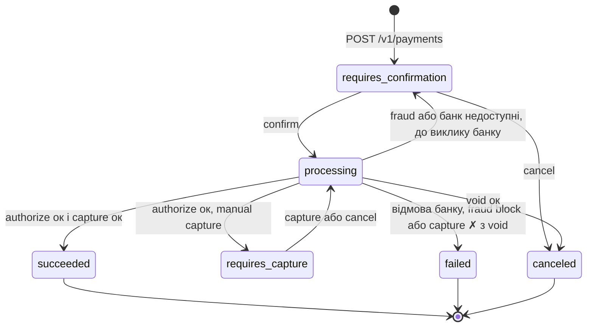
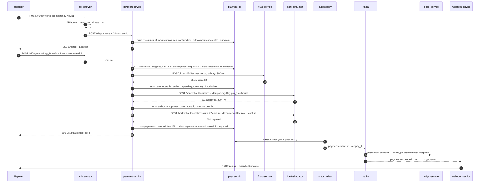
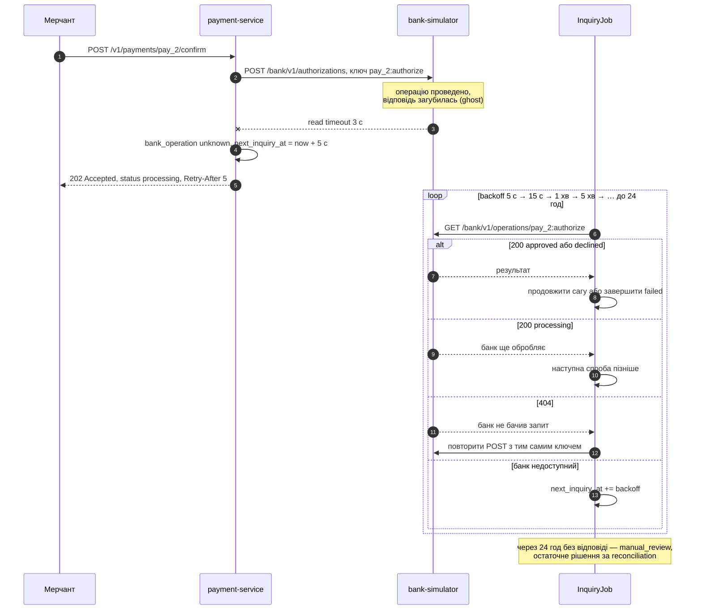
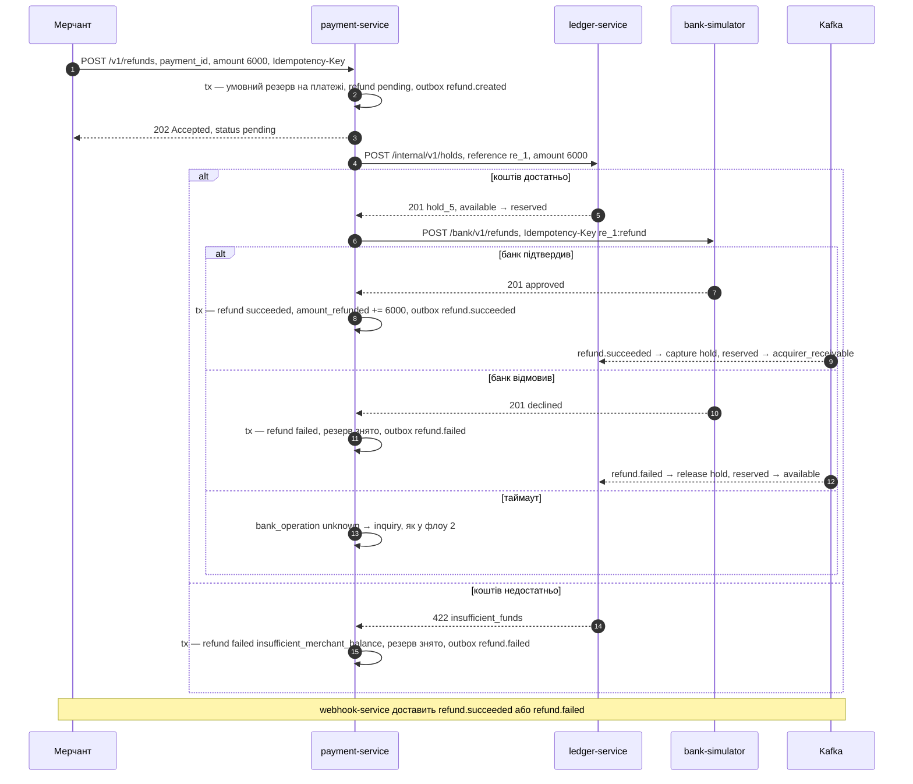
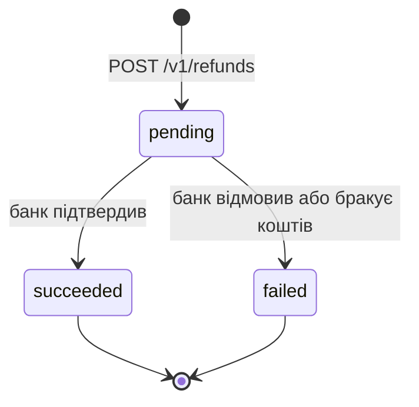
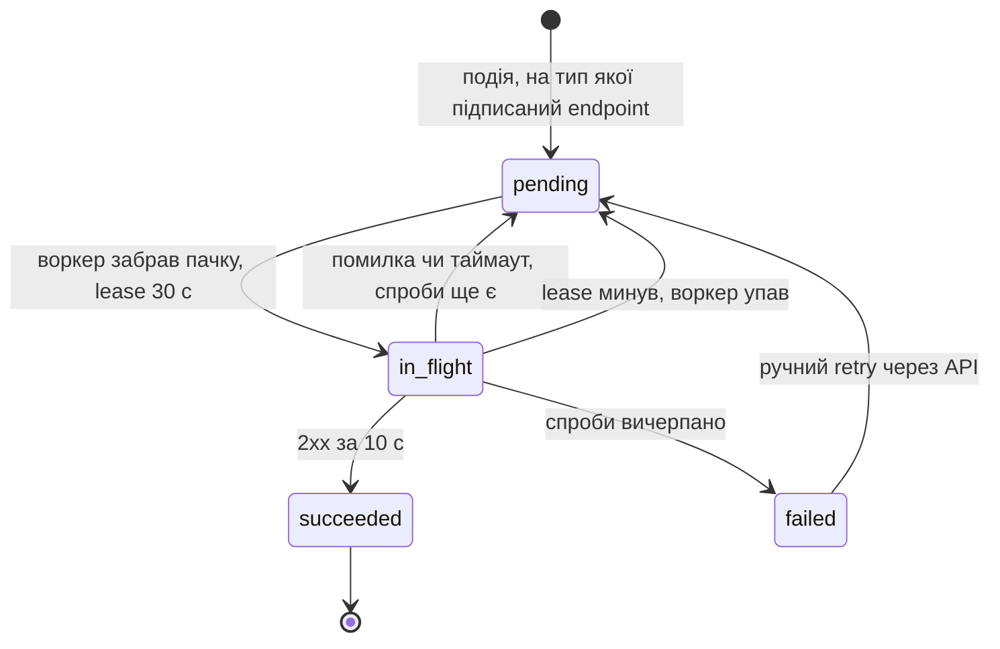
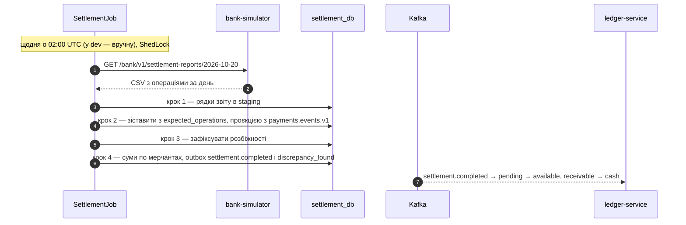

# 02. Ключові флоу

Тут описано, як рухаються дані й гроші, що відбувається при збоях і чому система від цього не ламається. SQL-запити, на які є посилання, наведено в [05-data-model.md](05-data-model.md).

## Стейт-машина платежу



- **Кожен перехід — умовний `UPDATE`:** `… WHERE id = ? AND status = <очікуваний>`. Якщо оновлено 0 рядків, хтось нас випередив. Мерчант у такому разі отримує `409 payment_unexpected_state`, а фонова задача просто пропускає рядок.
- **Внутрішній крок саги** зберігається в колонці `step`: `fraud_check` → `authorizing` → `capturing` | `voiding` | `awaiting_inquiry`. Назовні його не видно.
- **`succeeded`, `failed` і `canceled` — фінальні стани.** Повернення не змінюють статус платежу, тільки `amount_refunded`.

## Флоу 1. Створення й підтвердження платежу (automatic capture)



Що тут важливо:

1. **Створення платежу — одна транзакція.** Сам платіж, подія в outbox і збережена відповідь для ідемпотентності комітяться атомарно.
2. **Confirm — серія коротких транзакцій, між якими йдуть HTTP-виклики.** Жодна транзакція не лишається відкритою, поки чекаємо банк чи fraud: інакше з'єднання з пулу зайняті секундами, а рядки заблоковані.
3. **Пастка `@Transactional`.** Якщо розбити confirm на методи одного класу і викликати їх через `this`, транзакцій не буде: виклик іде повз Spring-проксі. Тому використовуємо `TransactionTemplate` або окремі біни.
4. **Write-ahead intent.** Операцію з банком записуємо в статусі `pending` і комітимо **до** HTTP-виклику. Якщо сервіс упаде посеред виклику, recovery-job знайде `pending` і з'ясує результат.
5. **Ключі ідемпотентності для банку детерміновані** (`pay_1:authorize`, `pay_1:capture`). Будь-який повтор безпечний: банк поверне той самий результат.
6. **Pivot — це capture.** Після нього рух тільки вперед: ledger і webhook-service отримують факт через outbox і Kafka, payment на них не чекає.

**Рішення fraud-service:**
- `block` → платіж `failed` з `fraud_blocked`.
- `review` → продовжуємо з `risk_level: elevated`.
- Fraud-service недоступний (таймаут або відкритий circuit breaker):
  - сума ≤ 5 000 грн-еквівалента → продовжуємо з `risk_level: elevated` (fail-open);
  - сума більша → платіж повертається в `requires_confirmation`, а мерчант отримує `503 fraud_check_unavailable` (fail-closed).

## Флоу 2. Таймаут банку → `unknown` → inquiry

Таймаут — **не** відмова: банк міг провести операцію і просто не встигнути відповісти.



Мерчант дізнається результат з вебхука або поллить `GET /v1/payments/pay_2` з `If-None-Match`. Поки статус не змінився, відповідь — `304`.

Той самий механізм підбирає операції, що «застрягли» в `pending` після падіння сервісу: recovery-job вважає `pending` старший за 30 с таким самим `unknown`.

## Флоу 3. Повтор запиту з тим самим Idempotency-Key

```text
POST з Idempotency-Key K від мерчанта M:
  hash := sha256(method + path + канонічний JSON тіла)   -- ключі відсортовані, без пробілів
  INSERT INTO idempotency_keys (M, K, hash, 'in_progress', locked_until = now() + 30 s)
      ON CONFLICT DO NOTHING
  якщо рядок вставлено → виконати операцію:
      успіх або бізнес-помилка 4xx  → зберегти статус і тіло відповіді, status = 'completed'
      5xx, і точно нічого не змінилось → DELETE ключа: повтор почнеться з нуля
      процес упав                    → нічого: lease закінчиться сам
  інакше → SELECT … FOR UPDATE:
      hash інший                     → 422 idempotency_key_mismatch
      completed                      → збережена відповідь + Idempotent-Replayed: true
      in_progress, lease ще діє      → 409 idempotency_key_in_use + Retry-After: 1
      in_progress, lease минув       → забрати lease і продовжити операцію з її збереженого стану
```

Останній рядок працює тому, що операцію можна продовжити з того місця, де вона зупинилась. Стан саги лежить у рядку платежу, а ключі для банку детерміновані. Це ідея «recovery points» зі статті Brandur Leach про ідемпотентність у Stripe. Сам Stripe зберігає навіть відповіді 5xx, ми свідомо ні.

## Флоу 4. Manual capture і автоскасування

1. **`capture_method: manual`.** Після authorize платіж переходить у `requires_capture` з `amount_capturable = amount` і `capture_before = now + 7 днів` (у dev — 10 хв).
2. **`POST /capture`** з `amount_to_capture ≤ amount_capturable`. Умовний перехід `requires_capture → processing`, capture у банку, далі `succeeded`. Несписаний залишок банк звільняє сам.
3. **`POST /cancel`.** Перехід `requires_capture → processing` (крок `voiding`), void у банку, далі `canceled`.
4. **`CaptureExpiryJob`** раз на хвилину бере прострочені платежі (`status = 'requires_capture' AND capture_before < now()`) через `FOR UPDATE SKIP LOCKED` і робить з ними те саме, що cancel. Причина скасування — `expired`.

**Гонка:** мерчант робить capture в ту саму мить, коли job робить void. Обидва виконують `UPDATE … WHERE status = 'requires_capture'`, і виграє рівно один. Другий отримує `409`, або job просто пропускає рядок.

## Флоу 5. Повернення: сага з холдом і компенсацією



- **Умовний резерв на платежі** працює без явних локів. Два паралельні повернення по 60 грн на платіж 100 грн: друге отримає 0 оновлених рядків і `422 refund_exceeds_captured`. Як остання лінія оборони стоїть `CHECK` у таблиці.
- **Hold ставимо синхронно**, бо відповідь потрібна до звернення в банк. **Завершуємо через події:** outbox гарантує, що ledger їх отримає, а ledger обробляє їх ідемпотентно.
- **Hold з `reference = re_1` ідемпотентний.** Якщо виклик ledger упав по таймауту, просто повторюємо його — ledger поверне той самий hold.
- **Холди не протухають автоматично.** Якщо сага застрягла в `unknown`, автоматичне звільнення могло б «повернути» мерчанту гроші, які банк уже віддав покупцю. Замість цього є алерт на hold, старший за 24 год, і розбір через reconciliation.



## Класифікація кроків саг

Термінологія з книги Chris Richardson «Microservices Patterns»:
- **compensatable** — крок, який можна скасувати;
- **pivot** — точка неповернення;
- **retriable** — кроки після pivot, які мусять колись завершитися успіхом. Тому вони ідемпотентні, а ретраяться без ліміту.

| Сага | Крок | Тип | Компенсація |
|---|---|---|---|
| Платіж | Fraud check | compensatable | не потрібна, нічого не змінює |
| Платіж | Authorize у банку | compensatable | void |
| Платіж | Capture у банку | **pivot** | — |
| Платіж | Проводка в ledger, вебхук | retriable | — |
| Повернення | Резерв суми на платежі | compensatable | зняти резерв |
| Повернення | Hold у ledger | compensatable | release через `refund.failed` |
| Повернення | Refund у банку | **pivot** | — |
| Повернення | Capture hold, вебхук | retriable | — |

## Флоу 6. Доставка вебхуків



- **Розклад:** перша спроба одразу, далі через 1 хв, 5 хв, 30 хв, 2 год, 6 год, 12 год, 24 год і 24 год. Разом ≈ 3 доби, до кожної затримки додається jitter ±20 %.
- **Успіх — тільки 2xx за ≤ 10 с.** Редиректи не виконуємо. `410 Gone` одразу вимикає endpoint, як і 3 доби суцільних невдач.
- **Підпис:** `Kopiyka-Signature: t=<unix-час>,v1=<hex HMAC-SHA256(secret, "<t>.<сире тіло>")>`. Під час ротації секрету передаємо два значення `v1`.
- **Порядок доставки не гарантуємо.** Мерчант дедуплікує події за `Kopiyka-Event-Id`, а актуальний стан завжди може взяти через `GET`.
- **Транзакцію не тримаємо під час HTTP-виклику.** Коротка транзакція забирає пачку (статус `in_flight` + lease), далі йдуть виклики, потім друга коротка транзакція записує результат. Запит на «забрати пачку» — у [05-data-model.md](05-data-model.md).

## Флоу 7. Settlement і reconciliation



Spring Batch зберігає стан job'а в JobRepository. Якщо job упав на кроці 3, перезапуск продовжить з кроку 3, тому кожен крок ідемпотентний.

| Розбіжність | Що означає | Дія |
|---|---|---|
| `missing_in_platform` | банк списав, а в нас `failed` чи `unknown` (ghost) | автоматичний refund покупцю + алерт |
| `missing_in_bank` | у нас `succeeded`, у банку запису немає | inquiry; якщо підтвердилось — ручний розбір |
| `amount_mismatch` | суми не збігаються | ручний розбір + алерт |

## Фонові задачі

| Задача | Сервіс | Частота | Як не задвоїти |
|---|---|---|---|
| Outbox poller (фаза 1) | усі продюсери | 200 мс | один активний інстанс через ShedLock: паралельні паблішери зламають порядок |
| Recovery операцій у `pending` | payment | 10 с | `SKIP LOCKED` |
| Inquiry операцій у `unknown` | payment | 5 с | `SKIP LOCKED` |
| Auto-void прострочених авторизацій | payment | 1 хв | `SKIP LOCKED` |
| Очистка idempotency keys старших за 24 год | payment, webhook | 1 год | ShedLock |
| Доставка вебхуків | webhook | 1 с | `SKIP LOCKED` + lease |
| Trial balance | ledger | 5 хв | ShedLock |
| Settlement і reconciliation | settlement | раз на добу | ShedLock + JobRepository |

## Сценарії збоїв

| Що сталося | Що робить система | Що бачить мерчант |
|---|---|---|
| Мерчант не отримав відповідь і повторив запит | `Idempotency-Key` віддає збережену відповідь | той самий результат + `Idempotent-Replayed: true` |
| Два паралельні confirm одного платежу | умовний `UPDATE`, виграє один | другий отримує `409 payment_unexpected_state` |
| payment-service упав між викликом банку і записом результату | операція лишилась у `pending` → recovery → inquiry → сага продовжується | `processing`, потім вебхук |
| Банк не відповів за 3 с | операція `unknown` → inquiry з backoff | `202 processing`, потім вебхук |
| Банк лежить (circuit breaker відкритий) | у банк не йдемо, платіж повертається в `requires_confirmation` | `503 bank_unavailable` + `Retry-After`. Повтор з тим самим ключем безпечний |
| fraud-service лежить | fallback: до порогу fail-open, вище — fail-closed | платіж з `risk_level: elevated` або `503` |
| Kafka лежить | outbox накопичується, API працює | баланс і вебхуки запізнюються |
| ledger-service лежить | події чекають у Kafka (consumer lag) | баланс оновиться пізніше, гроші не губляться |
| Подія прийшла двічі (рестарт Debezium, ребаланс) | `inbox` або унікальний `external_ref` → no-op | нічого |
| Повідомлення не десеріалізується (poison pill) | `ErrorHandlingDeserializer` → DLT + алерт | нічого |
| Endpoint мерчанта лежить | ретраї ≈ 3 доби, потім `failed` і ручний retry | події доступні через `GET /v1/events` |
| Два часткові повернення разом більші за платіж | умовний резерв, друге не проходить | `422 refund_exceeds_captured` |
| Capture мерчанта збігся з auto-void | умовний перехід, виграє один | `200` або `409` |
| Redis лежить | rate limiter пропускає запити (fail-open), ключі перевіряються напряму в merchant-service | трохи вища латентність |
| Ghost-операцію пропустив inquiry | reconciliation знаходить її у звіті банку → refund покупцю + алерт | нічого: покупець отримує гроші назад |
